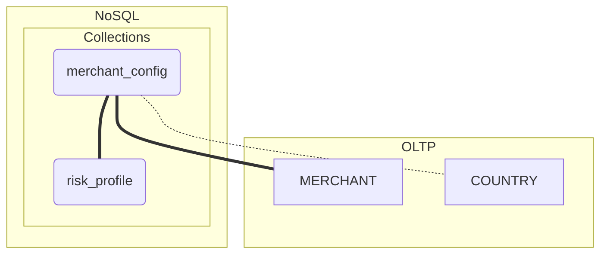

---
tags:
  - _RNCP38777
  - _2026
  - aia
  - aia/bc02
  - stripe-project
  - stripe-project/step-3
  - stripe-project/nosql
  - stripe-project/nosql/diagrams
  - stripe-project/nosql/diagrams/collections
  - stripe-project/nosql/diagrams/collections/merchant_config
---

